# Status, 17 November 2026

## Where things stand
- **Plan order (CLAUDE.md):** `docs/PLAN-fixes.md` first (the wedding), then the rest of `docs/PLAN-level1.md` Stage 0, then level 1 Stage 1 onward, then `docs/PLAN-hell.md`.
- **Now:** `docs/PLAN-fixes.md` is now v2.2: the wedding and the choke become a film of Karnika's still images, the game opens on the choke, and work on the 3D wedding stopped. Next step: Stage 0, the full playthrough recorded with sound, listing every sound gap or clipped line. **Mistake on 13 Nov:** after v2.1 said to leave `fixwedding.js` untouched, Code added the black water channels to it (commit 581a525, behind `?fix` only; the normal game is unchanged). That commit also carried the new plan file under a wrong message ("first box done"). Waiting for Karnika: keep the water or take it out.
- **Speed (laptop, two runs, 12 Nov):** river bank 54 to 55 fps, wedding 53 to 60 fps. Phone (emulated): river bank 46 fps, wedding 31 to 41 fps with slow moments at 20. First load 73.2 MB (budget 60). Details in `docs/budgets.md`.
- **Cache version:** `coin-v69` on the laptop (Chapter II fixes, 17 Nov); the public site is `coin-v78` (deployed 18 November 2026 with Karnika's yes: both chapters' fixes). **Public site:** coin.klickbaitbyk.com updated to this version on 13 November 2026 with Karnika's yes (it was on `coin-v13`). Normal game: https://coin.klickbaitbyk.com/play/ · new wedding: https://coin.klickbaitbyk.com/play/?fix
- **Branches not merged:** `cast-build` (bare 3D Thea and Mikon) and `clothes-agent` (cloth experiments); both wait for the character overhaul in the later lists.
- **Waiting for your yes:** fixing the small doc errors reported in chat; approving the light rocks (`look-test/Rocks before vs after.jpg`); scrubbing old Claude credit lines from git history.

## Every character up close (19 November 2026, Karnika's request: get it show-ready)
All 18 cast photographed on the look-dev page (front, back, face, seated, walking). Fixed: long skirts and robes followed every pocket of the trousers underneath (stepped, lumpy hems on Mikon, Orpheus, Elpenor, Theseus, Charon, Hades): long pieces are now smoothed by default; back cloaks stopped at the waist and hung like boards (Hermes, Orpheus, Theseus, Pirithous, Demeas, Lykon, the crowd): now to the calves, moving with chest and hips; women's gowns (Kleio, the dancer, the crowd) stopped at the knee in a stiff bell with trousers below: now to the floor; Charon's hood was in shards that threw dark blotches on his face: smoothed and casts no shadow; Pirithous's circlet sat crooked (removed). The party flashback now starts the moment you take the cake (after a delay you could walk off as it cut in). Both chapters played through, no errors. Cache `coin-v79`, not yet on the public site.

## Cold open (PLAN-fixes F1, in 3D until the stills arrive) and two looks (19 November 2026, Karnika's request)
Chapter I now opens on the goat joke and the choke (choke about 25 s after Begin, most of it the build behind the title card), then he wakes by the river; moving freely after 168 s (was 236 s; the plan's 60 s needs the Hermes wake talk shortened too). The rest of the wedding comes back as flashbacks: the funeral (nobody put the coin in) when he tells Elpenor "They forgot", and the party (arriving with the fish, the toast) when he picks up the honey cake. Each plays once, and not with `?nointro`. Played through to "You crossed", no errors.
Thea glowed white: the brides' "liquid silk" had a full white sheen, gloss and a little metal; now a soft sheen in the gown's own colour (Thea, Eurydice, Persephone). Hermes's hat wings stood up at 1.5x like two ears; now smaller and swept back along the crown.
**Then fitted (same day):** the realistic heads are now measured (head and hair, and the head alone), so flower crowns sit on the hair, crowns on the skull at the hairline (sized to the skull, not the buns), and earrings hang from each person's ear lobes; they were all placed at one height for everyone. Checked on the look-dev page: Thea, Eurydice, Persephone, Hades; Chapter II loads with no errors.
**Clothes recut (same day):** Hermes's long skirt and Hades's robe now use the smooth cut of Thea's column (no stepped hem, no legs through it, checked mid-walk); Persephone wears the column gown in pomegranate red with a dark sheer layer behind (the flared gown stood out like a box and showed the jacket collar). Both chapters load with no errors. Public site `coin-v78`, deployed 19 Nov with Karnika's yes.

## Script trimmed (18 November 2026, Karnika's confirmed list)
Cut, no re-recording: Mikon's narration "One moment I was laughing" and "Nobody put a coin under my tongue" in Chapter I's film (the scenes already show both; pauses keep the timing); Elpenor's story about Hermes's cattle and the "how long have you been waiting / nets" exchange. Shortened by playing only part of the recording (`TRIM` in game.js): Orpheus to Hermes now just "My name is Orpheus. My wife is Eurydice."; Mikon in Chapter II ends at "Good luck with Charon." (no ninety-nine years); his walk-out line starts at "Don't turn around" (no "Mate. Mate."). The servers don't answer range requests, so the late-starting clip is played from memory. The stills film (`?stills`) keeps its narration line. Cache `coin-v74`. Then the dog sleeps 35 s after the honey cake, not 25 (two runs reached Charon; cache `coin-v75`, on the public site 19 Nov).

## Both chapters played through again and fixed (18 November 2026, Karnika's request)
Chapter I played from Begin (film 269 s) to "You crossed", and again without the film; Chapter II's walk out played following the goal arrow to "You didn't look back". No page errors. Cache `coin-v72`.
1. **The game always opened on Chapter II** once Chapter I was finished (why Karnika couldn't play the first level). It now opens on Chapter I; Chapter II is picked in the palace. Checked with a save that has Chapter I done.
2. **Red screen on taking the coin:** cave rocks on the way to the coin had no collision, so you walked into them and the camera went inside the rock. Those rocks are left out now; the dog is in view as you take the coin.
3. **Charon's face burned orange and his eyes white:** the little light in his ember eyes sat a hand's width from his face. Turned down to a faint glow; the dock lantern also halved.
4. **Chapter I's how-to map** recoloured to match Chapter II (ivory and red on black).
5. **After Chapter I's film** you stood a step from a shade; you now start clear of it.
6. **Chapter II walk out:** the arrow pointed straight through the old sailor's camp; steering round it turned you to face Eurydice. It now leads up the clear walk to the arcade, then west.
**Seen, not changed:** Chapter I's film is 4 min 29 s before you can move (the plan turns it into a stills film); a ghost-like second of black after the title cards.

## Chapter II, The Lyre: played through and fixed (17 November 2026, Karnika's request, outside the plan order)
Played start to finish in a headless browser, walking, holding F, tapping the songs and pressing E like a player (`/play/?chapter=2`). The opening film runs 141 s before you can move; all 96 Chapter II voice lines have their audio; no page errors.
**Fixed** (about 13 lines changed in `orpheus.js`, `game.js`, `farbank.js`; cache `coin-v69`):
1. Cerberus never fell asleep: he slept only if his calm was full at the very moment you stepped through the gate, by which time your fingers had usually tired. The goal stayed "Get past Cerberus" all the way to Hades. Now he sleeps once calm (or once you're through the gate while he's nearly calm).
2. Because of that, he attacked during the walk out with Eurydice, when the lyre is put away; being caught turns you round to face her, so you lost through no fault of your own. He is now asleep for the whole walk out.
3. Backing up a step during the walk out (as anyone does after bumping into something) folded her trail back and brought her round in front of you: instant loss. Stepping back now rubs your steps off the trail; tested backing up 0.6 s and 1.5 s.
4. Big black boulders behind the House of Hades came through its back wall and hung over the thrones. Moved back and stood upright.
5. "Too deep. You can't swim" popped up when you bumped any wall or the hill on the far bank. Now only at the river.
6. The film's dying close-up of Eurydice: Orpheus kneels in front of her, his head crossed the lens and was cut open, so her face looked like a hole. The shot is now from beside her, with both faces in view.
7. Eurydice's "Are you still there?" played after "Goodbye, my love"; and a comment had hidden the line that shows Hymen's torch (it only mattered on a replay).
**Proof:** both endings reached ("You didn't look back" and "You looked back"); `look-test/Chapter II before vs after (17 Nov fixes).jpg`.
**Then fixed, at Karnika's word "fix everything" (17 November 2026):** the opening wedding is at night by candlelight (it was sunny noon) and the stream after it at night; the how-to map is ivory and red ink on black, re-centred so "the way up" shows, labels moved off the drawings; Sisyphus's hill moved behind his rock (it swallowed both to the waist) and a cold shaft of light put on him; the dock lantern moved to the last post, out of Charon's close-ups; soul lights capped in size so none swells into a glowing ball in front of the camera; Hades's hall has crimson drapes beside the columns and clusters of white candles on the dais; broken marble columns in the meadow; Hermes waits on the open beach in front of you; the dialogue options are bigger (up to 28 px) and brighter. Cache coin-v70. Headless playthrough of these running when pushed.

**Seen, not changed (for Karnika to decide):** the how-to map is pale cream and blue, labels sit on the drawings and "the way up" is cut off; the opening is a bright sunny wedding, far from the board; Sisyphus is half sunk into a black hill in near darkness; Charon's dock lantern sits in front of his face in his close-ups; a big glowing orb blooms in front of the camera on the dock; the House of Hades is a plain box and the meadow is bare; the dialogue choices are faint.

## PLAN-fixes Stage 1, first box: the wedding at night in the quarry (13 November 2026, in progress)
Behind `/play/?fix` only; the normal wedding is unchanged. New file `public/play/fixwedding.js` (about 80 lines) plus small hooks in `game.js`.
- **Done:** night (the sky's light all but gone, a dark warm haze, a black sky); quarry walls rising 18 m round the courtyard, lined with rows of candles, with ten warm lights so the rock reads as stone (none on phones); ivory sheers swagged high overhead; one burgundy drape falling from the north face; a dark floor; the green garlands and painted band hidden; the broad torch light turned down so the candles make the pools of light.
- **Not done yet:** the long channel of black water down the middle, the style frame's strongest feature. Today there are only the two short pools beside the high table.
- **Darkness (share of the frame at or below 10% brightness), same six moments as Stage 0:** wide shot 64.6% (was 40.9%), Lykon 39.7% (15.3%), Demeas's toast 51.2% (13.2%), goat joke 45.6% (20.2%), choking 36.1% (15.2%), funeral 60.0% (23.4%). Style frame: 39.5%. The rule in `docs/references.md` now matches the style frame (about 40%, 35 to 50 fine), as Karnika chose.
- **Speed, measured back to back:** laptop wedding 48 to 49 fps with `?fix`, 52 to 53 without (the game also softens the picture a little more with it). Emulated phone 24 to 25 fps with or without `?fix` at the same moment: the phone wedding was already under 30 there, so that is a problem of its own, not of this change. (12 November's 31 to 41 caught a different moment of the film.) First load unchanged, 73.2 MB.
- **Side by side:** `docs/fixes/wedding-stage1-progress.jpg` (before, after, style frame at six moments; full size in `look-test/`).
- **Still looks off:** the stone reads warm and blocky rather than rough grey rock; the guests' bright red and orange clothes (Stage 2).

## PLAN-fixes Stage 0: the wedding as it is (13 November 2026)
Measured only; nothing changed. Film recorded from Begin with the random scenery seeded, a screenshot every 5 seconds (`look-test/`, laptop only).

**Six moments next to the style frame:** `docs/fixes/wedding-stage0.jpg` (full size: `look-test/Wedding today vs style frame, six moments.jpg`). Value split measured on each frame without the black film bars: "dark" is at or below 10% brightness, "bright" at or above 80%.

| Moment | Dark | Mid | Bright |
|---|---|---|---|
| 15 s, opening wide shot | 40.9% | 58.8% | 0.3% |
| 30 s, Lykon saves a seat | 15.3% | 84.3% | 0.4% |
| 50 s, Demeas's toast | 13.2% | 86.7% | 0.0% |
| 80 s, the goat joke | 20.2% | 79.6% | 0.2% |
| 110 s, the choking | 15.2% | 84.3% | 0.5% |
| 140 s, the funeral | 23.4% | 76.3% | 0.4% |
| **Target: style frame 1** | 39.5% | 60.5% | 0.0% |
| Rule in `docs/references.md` | 45 to 55% | about 35% | about 10% |

What it shows: five of the six moments are about a third as dark as the style frame; only the high wide shot comes close. The scene is a sunset courtyard of brick, sky and warm floor, not the candlelit quarry. **Note:** the approved style frame itself measures 39.5% dark and almost no bright pixels (0.6% even at a looser 60% line), so it doesn't meet the rule's numbers either. Before Stage 1, decide which one is the target: the picture you approved or the numbers. Recommended: the picture, with the rule changed to match it.

**How long until the player can move:** the page is ready to press Enter about 9.5 s after opening; Enter to the chapter card's Begin is up to you (2 s in the test). From Begin, the player can first move after **250 seconds (4 minutes 10 seconds)**: the wedding film runs about 160 s (titles 0 to 15 s, the wedding 15 to 95 s, the choking 95 to 130 s, the funeral 130 to 160 s), then about 90 s of waking up with Hermes before control is handed over. Stage 3's limit is 90 seconds.

**Clipping (cloth inside the body), the eight named wedding characters, worst first** (`tools/check_clipping.mjs`, 12 frames per animation; a clip fails when more than 0.5% of the visible cloth is over 5 mm inside the body at any frame):

| Character | Clips failing | Worst clip (share over 5 mm) | At the table (the film's main pose) |
|---|---|---|---|
| Kleio | 20 of 20 | sitting and talking, 3.6% | fails |
| Thea (bride) | 5 of 20 | at the table talking, 2.6% | fails (all 5 failures are seated) |
| Nikias (groom) | 6 of 21 | coughing, 1.7% | fails when talking |
| Dancing guest | 16 of 20 | sitting, 1.5% | fails |
| Mikon | 15 of 21 | coughing, 1.0% | passes |
| Lykon | 4 of 21 | coughing, 1.0% | fails when talking |
| The piper | 1 of 21 | running, 0.5% | passes |
| Demeas | 0 of 21 | (passes everything) | passes |

Not checked: the 19 crowd extras (the tool takes one named character at a time). Reports are on the laptop only.

---

## Earlier: PLAN-level1 step A4, the current game, area by area (12 November 2026)
Taken today at fixed camera spots with the random scenery seeded, so the same shots can be retaken after any change. Full-size originals are on the laptop only; the copies here are small.

| # | Area | What happens there | Picture |
|---|---|---|---|
| 1 | Start screen | An inked palace map of the underworld; each chapter is a room. Chapter I, The Coin, is lit; II, The Lyre, is playable; III to VIII say "soon". | 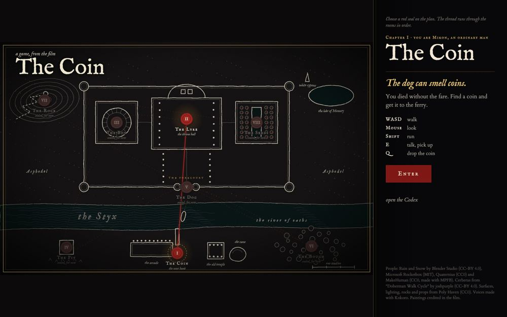 |
| 2 | Chapter card | "How to play": talk to people, find the coin in the dog's cave, put the dog to sleep with the honey cake from the temple altar, run the coin to Charon at the end of the dock. | 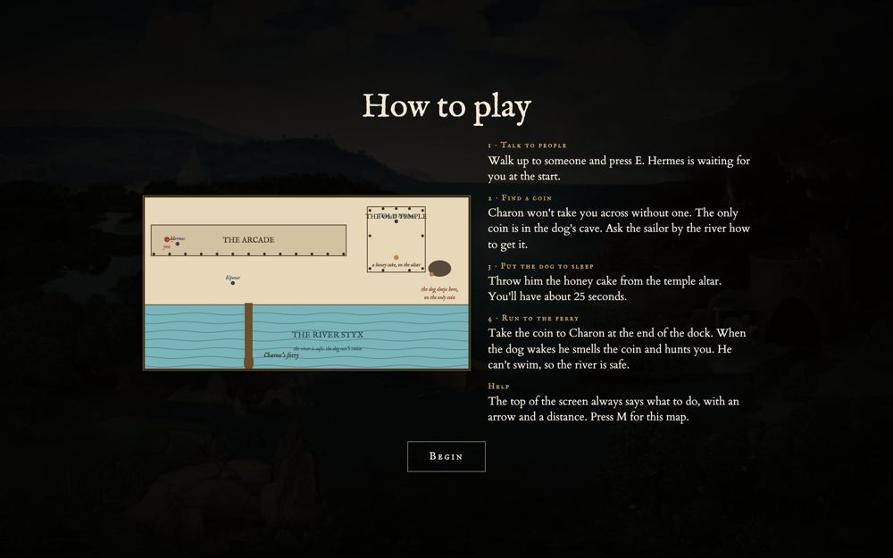 |
| 3 | Wedding film | The opening film: Thea's wedding in a courtyard at dusk, Lykon saving Mikon a seat, the olive. Played as a film, not playable. | 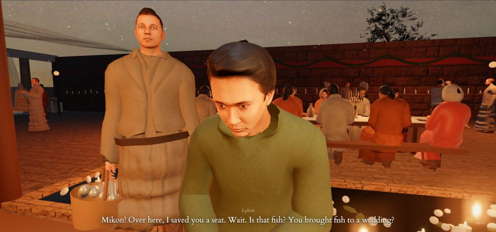 |
| 4 | Arcade (start) | Mikon wakes in a sandstone arcade with paintings on the wall; Hermes is waiting a few steps ahead and explains he's dead. | 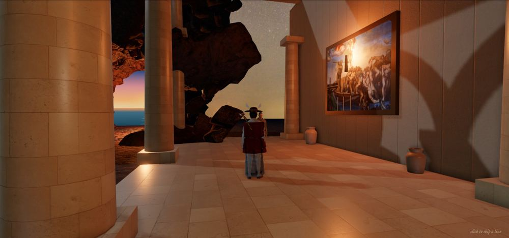 |
| 5 | Elpenor's camp | On the beach below the arcade: Elpenor (the sailor) and the waiting dead, jars, baskets, a lantern on his bench. He tells you how to get the coin. | 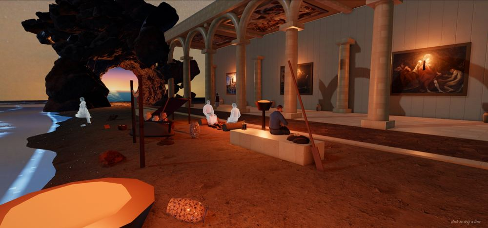 |
| 6 | Sunrise cave | The sea cave at the west end of the bank, opening on a painted sunrise. | 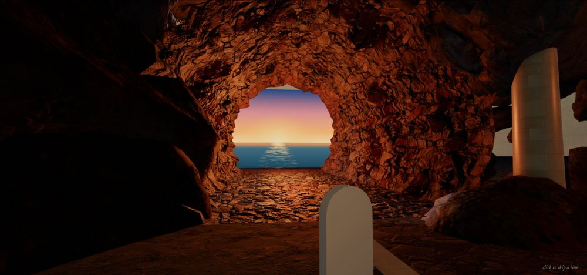 |
| 7 | Temple | Domed temple with stained glass and the falling Icarus; the altar with the honey cake; Theseus and Pirithous stuck to their stone chairs. | 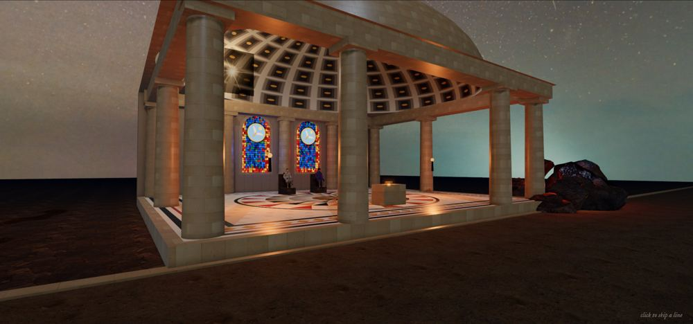 |
| 8 | Dog's cave | Heaped boulders at the east end of the bank; the dog guards the only coin. | 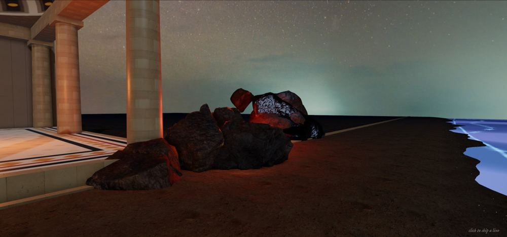 |
| 9 | Dock and boat | The wooden dock into the glowing river; Charon's ferry at the end. Paying him ends Chapter I. | 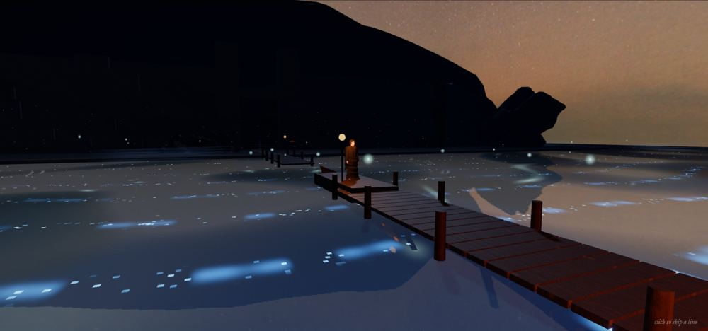 |
| 10 | The river | Looking from the dock across the Styx to the far bank; Charon on his boat. | 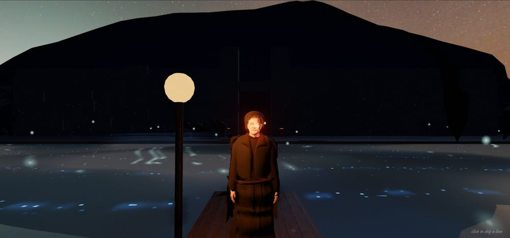 |
| 11 | Far bank, the gate | Landing, torches, and the gate where the dog waits (used in Chapter II). | 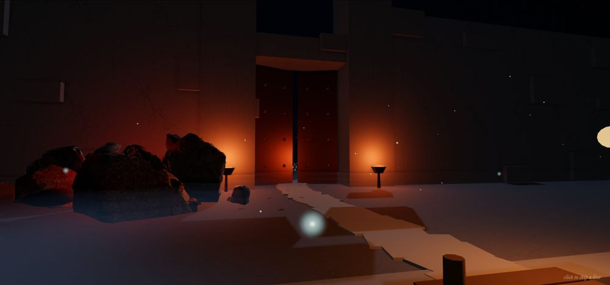 |
| 12 | Sisyphus | The field with Sisyphus and his boulder (Chapter II). | 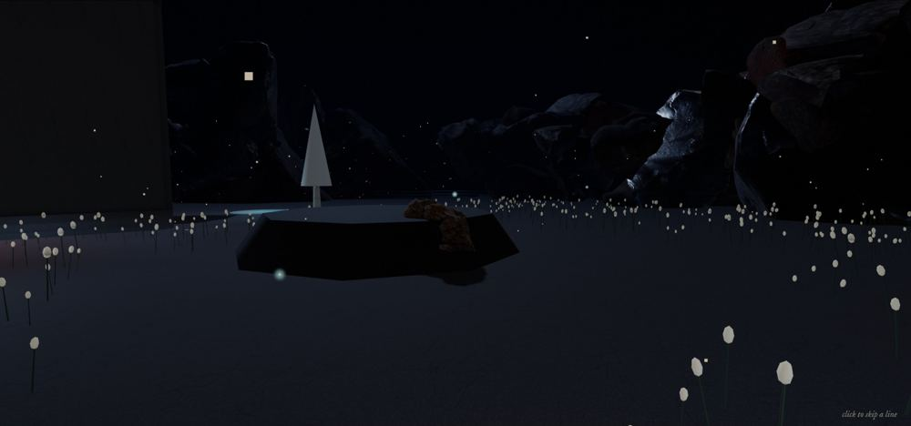 |
| 13 | Hades' hall | The thrones of Hades and Persephone (Chapter II). | 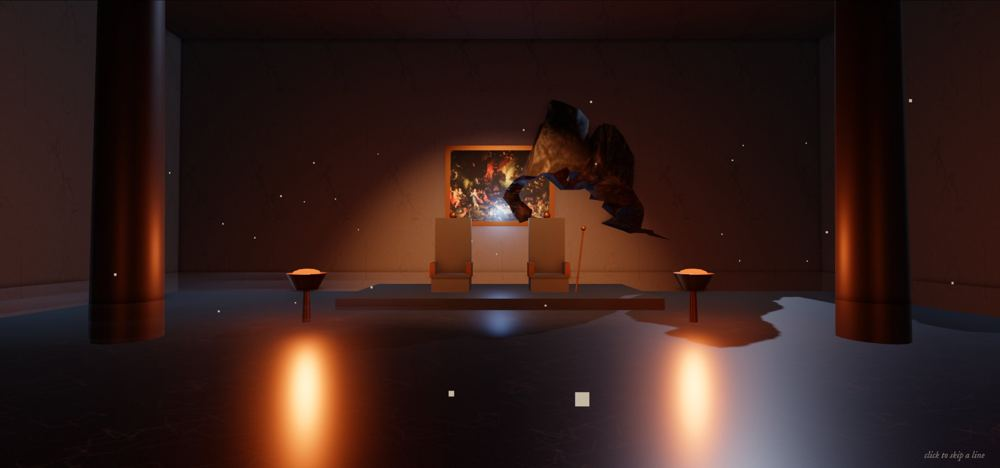 |

**The `?l1` switch:** added to `public/play/game.js` (5 lines). It marks the page and does nothing else yet. All 13 shots were retaken after the change, both normally and with `?l1`, and compared pixel by pixel: 10 of 13 differ by less than 1 percent (water, flames and film grain move between shots). The other three were checked by eye: the wedding film is a moving film caught at slightly different moments, and the dock and river showed rainbow smears on the water in some shots, with and without `?l1`.

**A bug found along the way and fixed:** the rainbow water came from the speed change of this morning (1bbfc7a). The river's mirror was refreshed every other frame, and sometimes it was refreshed during the soft-shadow pass, which paints every surface in diagnostic colours. The mirror now skips that pass. Twelve frames of the dock in a row: 4 of 12 had rainbow water before the fix, 0 of 12 after (`look-test/Water before fix (4 of 12 rainbow).jpg` and `Water after fix (0 of 12).jpg`).

**Unexplained:** one of five wedding test loads earlier today timed out while starting up, with no error message. The retry worked.

**Result for A4:** pass. The normal game and the opening film play as before, with no page errors in any run; speed is the same within run-to-run noise (river bank 52 to 53 fps before, 54 to 55 after; wedding 53 to 60 before, 53 to 60 after).
