# Status, 13 November 2026

## Where things stand
- **Plan order (CLAUDE.md):** `docs/PLAN-fixes.md` first (the wedding), then the rest of `docs/PLAN-level1.md` Stage 0, then level 1 Stage 1 onward, then `docs/PLAN-hell.md`.
- **Now:** `docs/PLAN-fixes.md` Stage 1, first box, in progress behind `/play/?fix` (below). Still to do in that box: the black water down the middle. Then the second box (candles going out row by row at the funeral).
- **Speed (laptop, two runs, 12 Nov):** river bank 54 to 55 fps, wedding 53 to 60 fps. Phone (emulated): river bank 46 fps, wedding 31 to 41 fps with slow moments at 20. First load 73.2 MB (budget 60). Details in `docs/budgets.md`.
- **Cache version:** `coin-v67`. **Public site:** coin.klickbaitbyk.com updated to this version on 13 November 2026 with Karnika's yes (it was on `coin-v13`). Normal game: https://coin.klickbaitbyk.com/play/ · new wedding: https://coin.klickbaitbyk.com/play/?fix
- **Branches not merged:** `cast-build` (bare 3D Thea and Mikon) and `clothes-agent` (cloth experiments); both wait for the character overhaul in the later lists.
- **Waiting for your yes:** fixing the small doc errors reported in chat; approving the light rocks (`look-test/Rocks before vs after.jpg`); scrubbing old Claude credit lines from git history.

## PLAN-fixes Stage 1, first box: the wedding at night in the quarry (13 November 2026, in progress)
Behind `/play/?fix` only; the normal wedding is unchanged. New file `public/play/fixwedding.js` (about 80 lines) plus small hooks in `game.js`.
- **Done:** night (the sky's light all but gone, a dark warm haze, a black sky); quarry walls rising 18 m round the courtyard, lined with rows of candles, with ten warm lights so the rock reads as stone (none on phones); ivory sheers swagged high overhead; one burgundy drape falling from the north face; a dark floor; the green garlands and painted band hidden; the broad torch light turned down so the candles make the pools of light.
- **Not done yet:** the long channel of black water down the middle, the style frame's strongest feature. Today there are only the two short pools beside the high table.
- **Darkness (share of the frame at or below 10% brightness), same six moments as Stage 0:** wide shot 64.6% (was 40.9%), Lykon 39.7% (15.3%), Demeas's toast 51.2% (13.2%), goat joke 45.6% (20.2%), choking 36.1% (15.2%), funeral 60.0% (23.4%). Style frame: 39.5%. The rule in `docs/references.md` now matches the style frame (about 40%, 35 to 50 fine), as Karnika chose.
- **Speed, measured back to back:** laptop wedding 48 to 49 fps with `?fix`, 52 to 53 without (the game also softens the picture a little more with it). Emulated phone 24 to 25 fps with or without `?fix` at the same moment: the phone wedding was already under 30 there, so that is a problem of its own, not of this change. (12 November's 31 to 41 caught a different moment of the film.) First load unchanged, 73.2 MB.
- **Side by side:** `docs/fixes/wedding-stage1-progress.jpg` (before, after, style frame at six moments; full size in `look-test/`).
- **Still looks off:** the stone reads warm and blocky rather than rough grey rock; the guests' bright red and orange clothes (Stage 2).

## PLAN-fixes Stage 0: the wedding as it is (13 November 2026)
Measured only; nothing changed. Film recorded from Begin with the random scenery seeded, a screenshot every 5 seconds (`look-test/`, laptop only).

**Six moments next to the style frame:** `docs/fixes/wedding-stage0.jpg` (full size: `look-test/Wedding today vs style frame, six moments.jpg`). Value split measured on each frame without the black film bars: "dark" is at or below 10% brightness, "bright" at or above 80%.

| Moment | Dark | Mid | Bright |
|---|---|---|---|
| 15 s, opening wide shot | 40.9% | 58.8% | 0.3% |
| 30 s, Lykon saves a seat | 15.3% | 84.3% | 0.4% |
| 50 s, Demeas's toast | 13.2% | 86.7% | 0.0% |
| 80 s, the goat joke | 20.2% | 79.6% | 0.2% |
| 110 s, the choking | 15.2% | 84.3% | 0.5% |
| 140 s, the funeral | 23.4% | 76.3% | 0.4% |
| **Target: style frame 1** | 39.5% | 60.5% | 0.0% |
| Rule in `docs/references.md` | 45 to 55% | about 35% | about 10% |

What it shows: five of the six moments are about a third as dark as the style frame; only the high wide shot comes close. The scene is a sunset courtyard of brick, sky and warm floor, not the candlelit quarry. **Note:** the approved style frame itself measures 39.5% dark and almost no bright pixels (0.6% even at a looser 60% line), so it doesn't meet the rule's numbers either. Before Stage 1, decide which one is the target: the picture you approved or the numbers. Recommended: the picture, with the rule changed to match it.

**How long until the player can move:** the page is ready to press Enter about 9.5 s after opening; Enter to the chapter card's Begin is up to you (2 s in the test). From Begin, the player can first move after **250 seconds (4 minutes 10 seconds)**: the wedding film runs about 160 s (titles 0 to 15 s, the wedding 15 to 95 s, the choking 95 to 130 s, the funeral 130 to 160 s), then about 90 s of waking up with Hermes before control is handed over. Stage 3's limit is 90 seconds.

**Clipping (cloth inside the body), the eight named wedding characters, worst first** (`tools/check_clipping.mjs`, 12 frames per animation; a clip fails when more than 0.5% of the visible cloth is over 5 mm inside the body at any frame):

| Character | Clips failing | Worst clip (share over 5 mm) | At the table (the film's main pose) |
|---|---|---|---|
| Kleio | 20 of 20 | sitting and talking, 3.6% | fails |
| Thea (bride) | 5 of 20 | at the table talking, 2.6% | fails (all 5 failures are seated) |
| Nikias (groom) | 6 of 21 | coughing, 1.7% | fails when talking |
| Dancing guest | 16 of 20 | sitting, 1.5% | fails |
| Mikon | 15 of 21 | coughing, 1.0% | passes |
| Lykon | 4 of 21 | coughing, 1.0% | fails when talking |
| The piper | 1 of 21 | running, 0.5% | passes |
| Demeas | 0 of 21 | (passes everything) | passes |

Not checked: the 19 crowd extras (the tool takes one named character at a time). Reports are on the laptop only.

---

## Earlier: PLAN-level1 step A4, the current game, area by area (12 November 2026)
Taken today at fixed camera spots with the random scenery seeded, so the same shots can be retaken after any change. Full-size originals are on the laptop only; the copies here are small.

| # | Area | What happens there | Picture |
|---|---|---|---|
| 1 | Start screen | An inked palace map of the underworld; each chapter is a room. Chapter I, The Coin, is lit; II, The Lyre, is playable; III to VIII say "soon". | 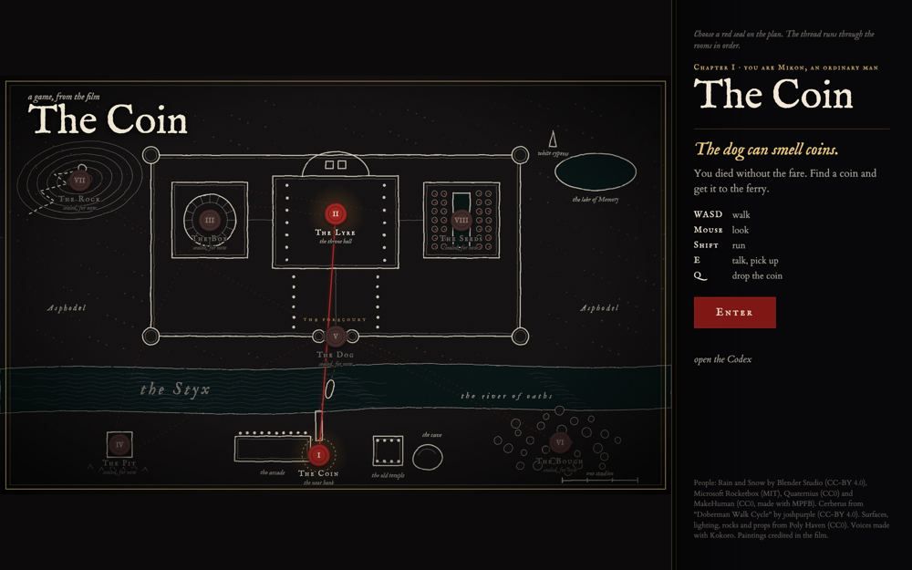 |
| 2 | Chapter card | "How to play": talk to people, find the coin in the dog's cave, put the dog to sleep with the honey cake from the temple altar, run the coin to Charon at the end of the dock. | 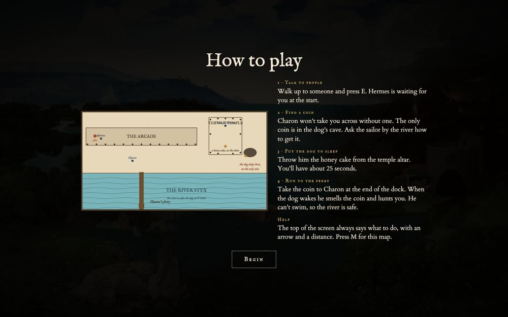 |
| 3 | Wedding film | The opening film: Thea's wedding in a courtyard at dusk, Lykon saving Mikon a seat, the olive. Played as a film, not playable. | 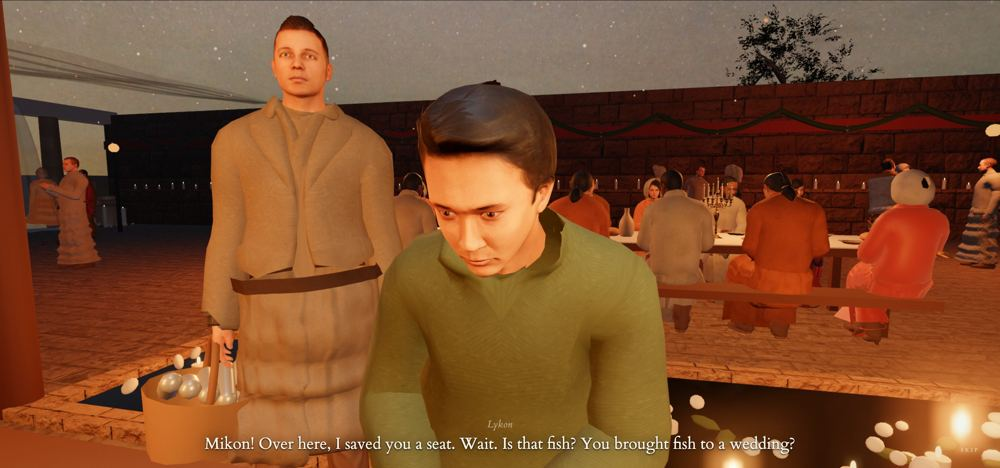 |
| 4 | Arcade (start) | Mikon wakes in a sandstone arcade with paintings on the wall; Hermes is waiting a few steps ahead and explains he's dead. | 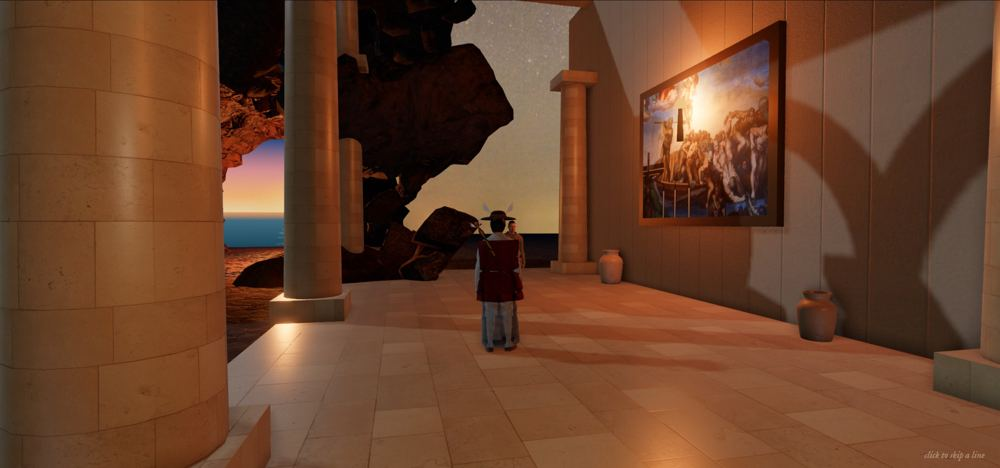 |
| 5 | Elpenor's camp | On the beach below the arcade: Elpenor (the sailor) and the waiting dead, jars, baskets, a lantern on his bench. He tells you how to get the coin. | 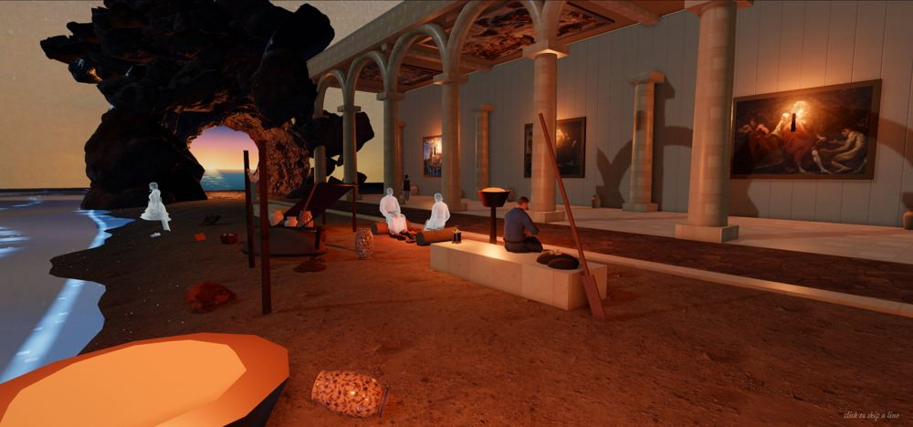 |
| 6 | Sunrise cave | The sea cave at the west end of the bank, opening on a painted sunrise. | 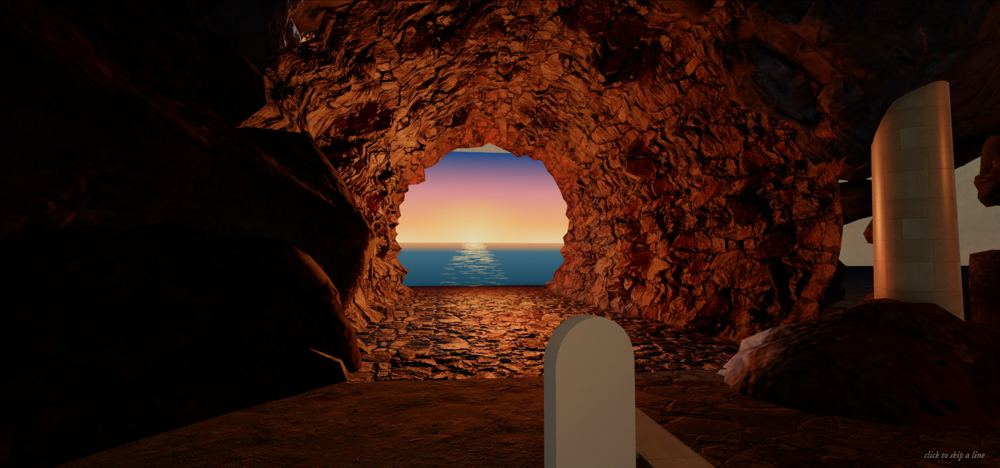 |
| 7 | Temple | Domed temple with stained glass and the falling Icarus; the altar with the honey cake; Theseus and Pirithous stuck to their stone chairs. | 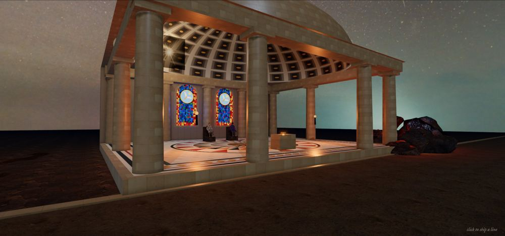 |
| 8 | Dog's cave | Heaped boulders at the east end of the bank; the dog guards the only coin. | 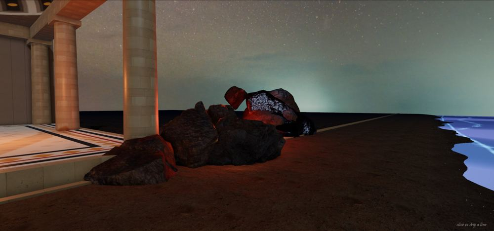 |
| 9 | Dock and boat | The wooden dock into the glowing river; Charon's ferry at the end. Paying him ends Chapter I. | 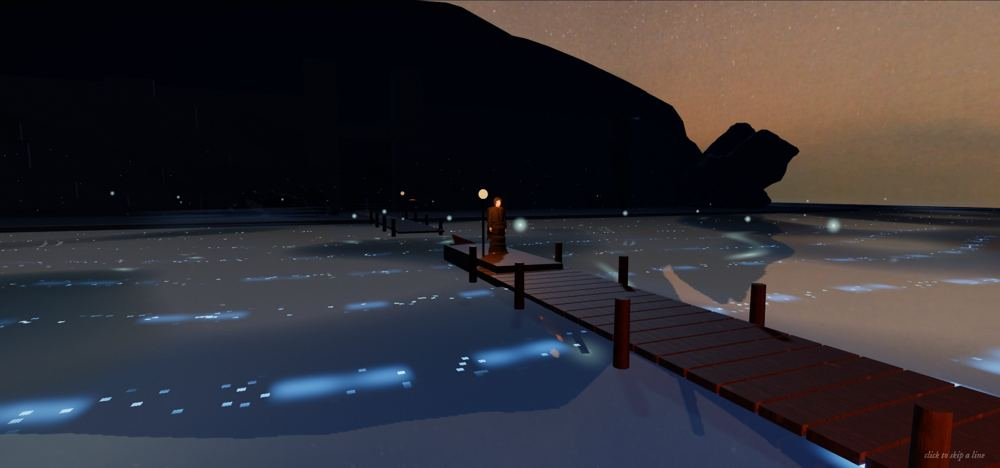 |
| 10 | The river | Looking from the dock across the Styx to the far bank; Charon on his boat. | 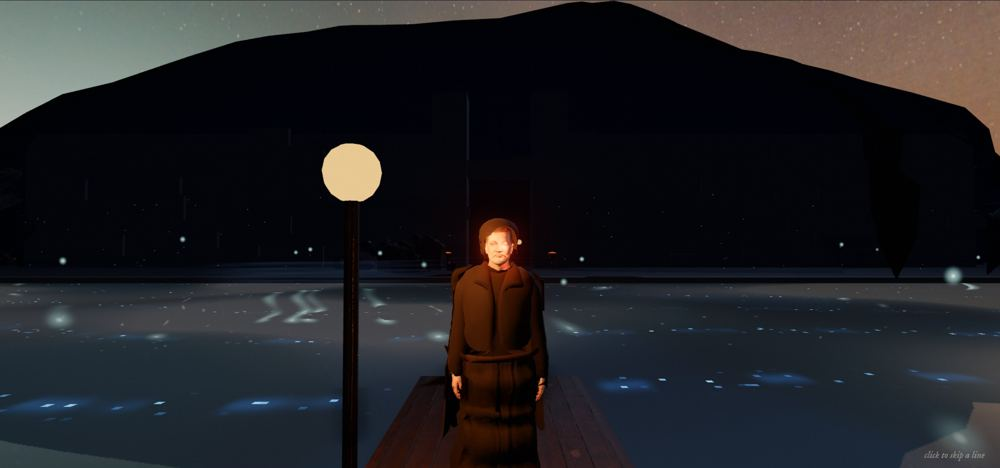 |
| 11 | Far bank, the gate | Landing, torches, and the gate where the dog waits (used in Chapter II). | 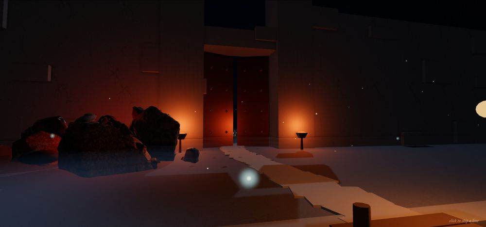 |
| 12 | Sisyphus | The field with Sisyphus and his boulder (Chapter II). | 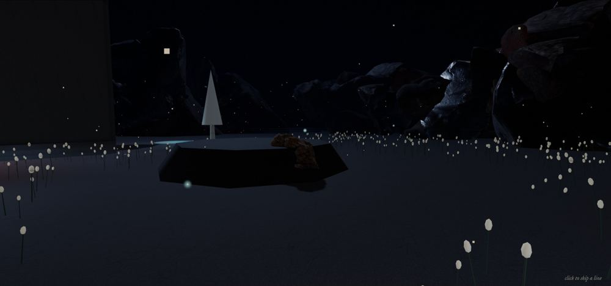 |
| 13 | Hades' hall | The thrones of Hades and Persephone (Chapter II). | 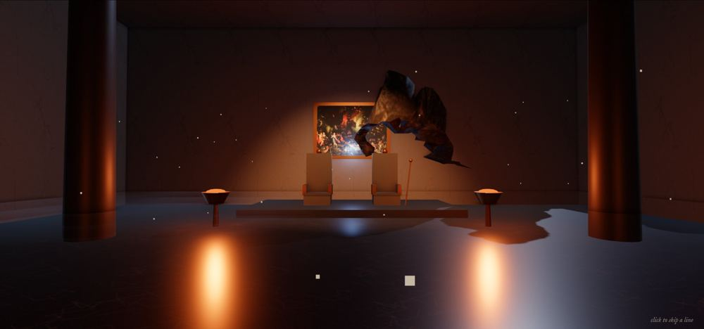 |

**The `?l1` switch:** added to `public/play/game.js` (5 lines). It marks the page and does nothing else yet. All 13 shots were retaken after the change, both normally and with `?l1`, and compared pixel by pixel: 10 of 13 differ by less than 1 percent (water, flames and film grain move between shots). The other three were checked by eye: the wedding film is a moving film caught at slightly different moments, and the dock and river showed rainbow smears on the water in some shots, with and without `?l1`.

**A bug found along the way and fixed:** the rainbow water came from the speed change of this morning (1bbfc7a). The river's mirror was refreshed every other frame, and sometimes it was refreshed during the soft-shadow pass, which paints every surface in diagnostic colours. The mirror now skips that pass. Twelve frames of the dock in a row: 4 of 12 had rainbow water before the fix, 0 of 12 after (`look-test/Water before fix (4 of 12 rainbow).jpg` and `Water after fix (0 of 12).jpg`).

**Unexplained:** one of five wedding test loads earlier today timed out while starting up, with no error message. The retry worked.

**Result for A4:** pass. The normal game and the opening film play as before, with no page errors in any run; speed is the same within run-to-run noise (river bank 52 to 53 fps before, 54 to 55 after; wedding 53 to 60 before, 53 to 60 after).
